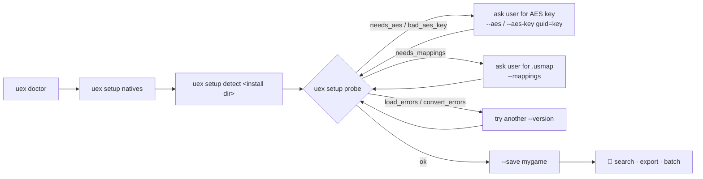

# 3L0935/uex

Headless, JSON-speaking Unreal Engine (UE4/UE5) asset extractor for scripts and AI agents - built on CUE4Parse

URL: https://github.com/3L0935/uex

## Why it matters
You saved an article on 2026-11-11 about AI agents; this candidate overlaps with "Show HN: Mimzie, an agent-neutral alternative to the Claude Suite/Claude Cowork" and may turn that reading into a practical workflow improvement.

## Pros
+ Recently updated (2026-11-19)
+ MIT license
+ GitHub Actions/CI detected
+ README mentions tests or validation

## Cons
- README mentions credentials or API tokens

## Repository Inspection
README quality: 100/100
CI detected: yes
Tests mentioned: yes
Setup steps estimate: 1

Dependency files:
- none detected

Install commands found:
- git clone https://github.com/3L0935/uex && cd uex
- pip install -r tools/uexgif/requirements.txt

Risk flags:
- README mentions credentials or API tokens

## Install
Nothing runs automatically. Review the upstream README before running any install command.

## README
<div align="center">

<pre>
 ██╗   ██╗███████╗██╗  ██╗
 ██║   ██║██╔════╝╚██╗██╔╝
 ██║   ██║█████╗   ╚███╔╝
 ██║   ██║██╔══╝   ██╔██╗
 ╚██████╔╝███████╗██╔╝ ██╗
  ╚═════╝ ╚══════╝╚═╝  ╚═╝
</pre>

### Unreal Engine EXtractor - a headless, JSON-speaking FModel for scripts and AI agents

Browse and extract any UE4 / UE5 game's `.pak` / `.utoc` archives from the command line.<br>
Meshes, textures, materials, animations, sounds, data tables and whole levels, with no GUI and no clicking.<br>
Every answer is **one clean JSON document**.

[](https://github.com/3L0935/uex/actions/workflows/build.yml)
[](https://github.com/3L0935/uex/releases/latest)


[](LICENSE)


[Quick start](#-quick-start) · [Agents](#-made-for-agents) · [Set up any game](#-set-up-any-game-in-5-commands) · [Commands](#-commands) · [Config](#-configuration) · [FAQ](#-faq)

</div>

---

## ✨ Why

[FModel](https://github.com/4sval/FModel) is great for browsing by hand. But when a pipeline needs 300 meshes, a level layout as JSON, or every sound bank of a character, you want a **tool you can call**, not a window you have to click through.

**uex** puts the same engine, [CUE4Parse](https://github.com/FabianFG/CUE4Parse), behind a strict command-line contract:

| | |
|---|---|
| 🤖 **Agent-native** | One JSON envelope on stdout, logs on stderr. Errors carry stable codes, a hint and suggestions (`didYouMean`). The CLI describes itself (`uex help`). |
| 🎮 **Any UE game** | Per-game profiles: paks folder, CUE4Parse version, AES keys, `.usmap` mappings and export defaults. |
| 🧭 **Guided setup** | `detect` finds the Paks folder and reads the engine version from the executable. `probe` tests keys and mappings and returns a verdict. |
| ⚡ **Batch mode** | Mount once, run hundreds of commands, get NDJSON back. |
| 🐧 **Cross-platform** | Self-contained single binary for Windows and Linux, with no runtime to install. Windows is validated on real games. Linux runs in CI (contract and natives download) but has not been tested on a real game yet. |
| 🔐 **Secret-safe** | AES keys stay in your local config. uex never prints them. |
| 📦 **Faithful exports** | On the reference game, psk/pskx/psa, PNG, raw files and property JSON came out **byte-identical** to a direct CUE4Parse export. glTF, UEFormat and USD (levels) are also available. |

## 🚀 Quick start

**Install.** Download the binary for your OS from [Releases](https://github.com/3L0935/uex/releases/latest).

```bash
# Linux
curl -fsSL https://github.com/3L0935/uex/releases/latest/download/uex-linux-x64.tar.gz | tar -xz -C ~/.local/bin
```
```powershell
# Windows
Invoke-WebRequest https://github.com/3L0935/uex/releases/latest/download/uex-win-x64.zip -OutFile uex.zip; Expand-Archive uex.zip "$env:LOCALAPPDATA\uex"
```

**First run.**

```bash
uex setup natives --from "<FModel>/Output/.data"     # Oodle/zlib/Detex decompressors (or --download)
uex setup detect "D:/SteamLibrary/steamapps/common/MyGame"
uex setup probe --paks "D:/.../MyGame/Content/Paks" --version GAME_UE5_5 --aes 0x… --save mygame
uex search "SM_.*Chair"
uex export /Game/Props/SM_Chair_01 --out ./rips
```

```jsonc
{
  "ok": true,
  "command": "export",
  "game": "mygame",
  "data": {
    "outDir": "/home/me/rips",
    "ok": 1, "failed": 0,
    "items": [{
      "path": "/Game/Props/SM_Chair_01",
      "ok": true,
      "class": "StaticMesh",
      "files": ["…/SM_Chair_01.pskx", "…/MI_Chair_Wood.json", "…/T_Chair_Wood_BC.png", "…"]
    }]
  }
}
```

## 🤖 Made for agents

uex ships with a **skill** that teaches an AI agent how to install it, set up a game and use every command: [`skills/uex/SKILL.md`](skills/uex/SKILL.md).

**Claude Code:**

```bash
/plugin marketplace add 3L0935/uex
/plugin install uex@uex
```

The skill is then available as `/uex:uex`. You can also copy just the `skills/uex/` folder to `~/.claude/skills/uex/` to get a personal `/uex` skill; pick one method, not both. Other agents (Codex, Cursor, Aider…) can be pointed at [`AGENTS.md`](AGENTS.md).

### The contract

```jsonc
// success
{"ok": true,  "command": "search", "game": "mygame", "data": {"total": 3, "items": ["…"]}, "warnings": ["…"]}
// failure: always a machine code + a human hint
{"ok": false, "command": "types", "error": {"code": "not_found", "message": "…", "hint": "…",
                                            "details": {"didYouMean": ["MyGame/Content/Props/SM_Chair_01.uasset"]}}}
```

| exit | meaning | `error.code` |
|:---:|---|---|
| `0` | ok | |
| `1` | partial: some items failed | |
| `2` | usage | `usage` `unknown_command` `bad_argument` |
| `3` | configuration | `no_config` `unknown_game` `bad_version` `bad_key` `bad_config` `game_exists` |
| `4` | mount | `mount_failed` `paks_not_found` |
| `5` | not found | `not_found` |
| `6` | native missing | `missing_native` |
| `7` | output too large for stdout | `output_too_large` |
| `8` | package failed to parse | `load_failed` |

There are no interactive prompts and no colors on stdout. Listings are paged (`total`/`offset`/`limit`/`truncated`), and large property dumps are sent to `--out`, so they cannot flood the agent's context.

## 🧭 Set up any game in 5 commands



`setup detect` scans the install folder. It returns:
- the Paks folder (and whether archives sit in subfolders);
- whether the game uses IoStore;
- the **engine version** read from the executable (`++UE5+Release-5.x` or the PE version resource, parsed by hand so it also works on Linux);
- any **game-specific CUE4Parse version** (custom engine forks, e.g. `GAME_DeadByDaylight`);
- the exact probe command to run next.

`setup probe` mounts **without saving** and returns:
- the archives still locked, grouped by **key GUID**;
- how many archives each submitted key opened;
- a check that each AES key really decrypts (wrong keys are rejected, never silently "mounted");
- a parse test on packages sampled across the game, then a **real conversion** of a few meshes and textures. A wrong version can parse properties yet fail meshes, and this step catches it;
- a `verdict` (`ok`, `needs_aes`, `bad_aes_key`, `partial_aes`, `needs_mappings`, `load_errors`, `convert_errors`, `no_packages`) with hints.

When it is green, add `--save <id>` and you are done.

> uex cannot find AES keys or mappings for you. They come from you, or from a source you trust. Already configured a game in FModel? Run `uex games import-fmodel` to pull in its folder, version, keys and mappings.

## 🧰 Commands

| command | what it does |
|---|---|
| `help [cmd]` | full machine-readable spec of every command |
| `doctor` | OS, config path, natives found, configured games |
| `versions [--filter re]` | valid CUE4Parse version names |
| `setup detect <dir>` | find paks, engine version and version candidates |
| `setup probe …` | test a configuration and get a verdict; `--save <id>` stores it |
| `setup natives [--from dir] [--download]` | install oodle / zlib-ng / ACL / Detex for this OS |
| `games list \| show \| add \| set \| remove \| default \| import-fmodel` | manage profiles |
| `info` | files, archives mounted or locked, mappings in use |
| `ls [dir] [--all]` | browse virtual folders (paged) |
| `search <regex> [--ext bnk] [--all]` | find files by path (paged) |
| `types <pkg>` | export classes of a package |
| `props <pkg> [--export n] [--class c] [--out f]` | properties as JSON |
| `export <pkg>… [--list f\|-]` | meshes (+materials +textures), textures, animations, materials; anything else as JSON |
| `raw <file>…` | raw bytes (`.bnk`, `.wem`, `.ini`, `.uasset`…) |
| `map <pkg>` | a whole level (World) as a USD scene; DBD-style tile maps also accept `--format gltf\|actorx\|ueformat` |
| `batch <file\|->` | many commands, one mount, NDJSON out |

Paths can be given as mount paths (`MyGame/Content/X.uasset`, exactly as `search` prints them) or in the usual Unreal forms: `/Game/X`, `/Game/X.X`, `Class'/Game/X.X'`, `/Game/X.X:Sub`.

### Batch

```bash
cat <<'EOF' | uex batch - -g mygame
search "Weapons/.*/SK_" --limit 500
export /Game/Weapons/Rifle/SK_Rifle --out rips --mesh-format Gltf2
props /Game/Data/DT_WeaponStats --out rips/weapon_stats.json
raw MyGame/Content/WwiseAudio/Cooked/Weapons.bnk --out rips/audio
EOF
```

One mount, one JSON line per command, then a summary line.

## ⚙️ Configuration

The config is a JSON file. uex picks the first one that exists, in this order:
1. `--config <file>`;
2. `$UEX_CONFIG`;
3. `uex.config.json` next to the binary (portable mode);
4. `%APPDATA%\uex\config.json` on Windows, or `~/.config/uex/config.json` on Linux.

```jsonc
{
  "schema": 1,
  "defaultGame": "mygame",
  "nativesDir": null,                       // default: <config dir>/natives
  "games": {
    "mygame": {
      "name": "My Game",
      "paks": "D:/SteamLibrary/steamapps/common/MyGame/MyGame/Content/Paks",
      "recursive": false,                   // also mount archives in sub-folders
      "extraPaks": [],
      "version": "GAME_UE5_5",              // any `uex versions` name
      "aes": { "main": "0x…", "dynamic": { "<32-hex guid>": "0x…" } },
      "mappings": "D:/maps/MyGame.usmap",   // file, or folder (newest .usmap wins)
      "export": { "meshFormat": "ActorX", "textureFormat": "Png", "materialDepth": "TopLayerOnly", "meshQuality": "Highest", "exportMaterials": true }
    }
  }
}
```

Paths accept `~`, `%VAR%`, `$VAR` and `${VAR}`. Select a game with `-g <id>` or `$UEX_GAME`; otherwise uex uses the default game.

### Natives

CUE4Parse uses optional native libraries. uex never bundles them. Instead, `uex setup natives` copies them from a folder you point it to, or downloads the ones CUE4Parse knows how to fetch.

| id | needed for | Windows | Linux |
|---|---|---|---|
| `oodle` | Oodle-compressed archives (most modern games) | `--download`, or `--from` FModel's `.data` | `--download` |
| `zlib` | zlib-compressed archives | `--download`, or `--from` FModel's `.data` | `--download` |
| `acl` | **animation** export (ACL codec) | `CUE4Parse-Natives.dll`, e.g. from FModel | build `libCUE4Parse-Natives.so` from CUE4Parse |
| `detex` | rare texture formats | `Detex.dll`, e.g. from FModel | - |

## 🏗️ Build from source

```bash
git clone https://github.com/3L0935/uex && cd uex
dotnet publish -c Release -r linux-x64 --self-contained true -p:PublishSingleFile=true -p:IncludeNativeLibrariesForSelfExtract=true -o out   # or win-x64
./out/uex doctor
```

You need the .NET 10 SDK.

> `dotnet build` prints NuGet audit warnings for `SixLabors.ImageSharp` 3.1.12 and `Microsoft.Bcl.Memory` 9.0.0. Both come from CUE4Parse-Conversion, which pins ImageSharp to that exact version, so uex cannot bump them on its own.

## 🖼️ Optional tool: uexgif (preview GIFs)

[`tools/uexgif/`](tools/uexgif/) turns an export into something you can look at: it reads
the `.psk` meshes and `.png` textures `uex export` just wrote, assembles every part
(body, outfit, mask) in the bind pose, and renders the model turning on itself as a GIF.
No GPU, no Blender, no engine — numpy + Pillow.

```bash
pip install -r tools/uexgif/requirements.txt
python3 tools/uexgif/uexgif.py rips/body rips/mask1978 rips/suit1978 \
        -o preview.gif --frames 32 --size 480x640
```

It reads the `MI_*.json` material files uex writes next to each mesh, so albedo and
opacity come from the real material (hair stays hair instead of white planes), and
`--sun`, `--ambient`, `--exposure` tune the shot. `--format webp` gives an animated WebP
instead of a GIF, `--format sprites` a PNG sheet; `--frames-dir` keeps the frames so you
can hand them to ffmpeg for a video.

Pure Python (numpy + Pillow), Linux/macOS/Windows. Bind pose only: applying a `.psa`
needs skinning, which is not implemented yet.

## ❓ FAQ

<details>
<summary><b>Is this a FModel replacement?</b></summary>

For automation, yes. For browsing by hand, no: FModel has previews, a 3D viewer and audio playback. uex is the same engine with the GUI swapped for a contract that programs can rely on.
</details>

<details>
<summary><b>Where do AES keys and .usmap mappings come from?</b></summary>

From you. uex reads static files on disk. It does not dump game memory, touch running processes, or query key databases. If the game is encrypted, `setup probe` tells you exactly which key GUIDs are missing.
</details>

<details>
<summary><b>My UE5 game loads, but every package fails</b></summary>

That is almost always missing or stale mappings: `verdict: needs_mappings`. A game update usually needs a new `.usmap`.
</details>

<details>
<summary><b>Searching from Git Bash on Windows returns nonsense paths</b></summary>

MSYS rewrites `/Game/...` into `C:/Program Files/Git/Game/...`. uex undoes that automatically. You can also use mount paths (`MyGame/Content/...`) or `MSYS_NO_PATHCONV=1`.
</details>

<details>
<summary><b>Status on Linux?</b></summary>

The Linux x64 binary runs in CI on Ubuntu: JSON contract, exit codes, and `setup natives --download`, which fetches Oodle and zlib-ng. It **has not been run against a real game yet**; reports are welcome. Animation export on Linux needs a self-built `libCUE4Parse-Natives.so`.
</details>

## ⚖️ Legal

uex only reads files you already have on disk. Assets extracted from a game remain the property of their owners and are covered by that game's EULA. Use them for modding, research and personal projects where the license allows it. No keys, mappings or game data are shipped with this project.

## 💜 Credits

- [**CUE4Parse**](https://github.com/FabianFG/CUE4Parse) by FabianFG and contributors does all the actual parsing. uex is a thin, opinionated shell around it.
- [**FModel**](https://github.com/4sval/FModel) by 4sval and contributors: the reference GUI, and the inspiration.

<div align="center"><sub>MIT © 2026 · built for pipelines that never sleep</sub></div>

